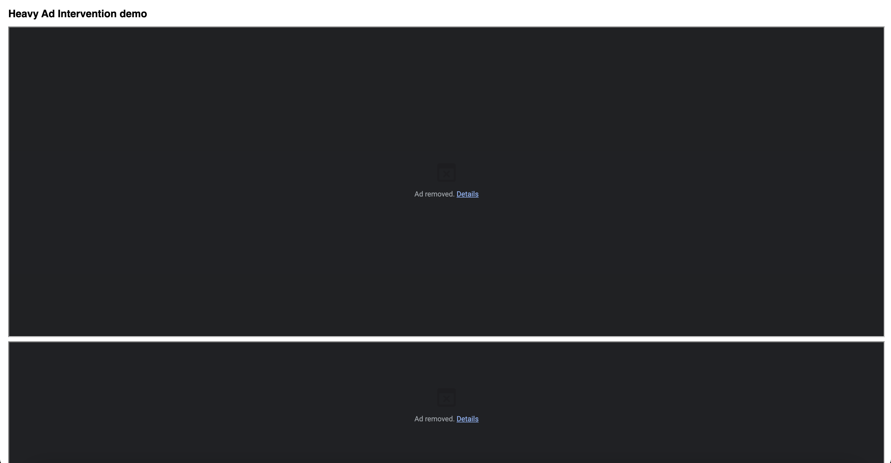

# Heavy-Ad Intervention Test Stand

Live demo: https://dimaturishchev.github.io/heavy.html  

This repo contains a minimal test page that forces Chrome’s Heavy-Ad Intervention: one iframe exceeds the network limit, the other the CPU limit.

## Stable steps to reproduce

1. Host **heavy.html** together with the **ads/** folder somewhere, or use the live demo above (if still online).  
2. Create a **new Chrome profile** (see [why](#why-a-new-chrome-profile)).  
3. Navigate to **heavy.html** in that profile.  
4. The **network frame** is killed almost immediately.  
5. The **CPU frame** is killed in about 15 seconds in the current implementation (12 July 2025, Chrome 138.0.7204.101).

## Why a new Chrome profile

Chrome stops removing heavy ads on a site once it has removed 5 there within
24 hours. The count is kept per host of the page in the tab (not per URL or per
ad), lasts until 24 hours after the latest removal, and is saved in the profile
(`heavy_ad_intervention_opt_out.db`), so restarting Chrome doesn't reset it.
Each load of heavy.html uses up two removals, so on the third load the CPU frame
is no longer removed, and from the fourth load neither frame is. A new profile
starts with a clean count.

## How the frames get tagged as ads

Heavy-Ad Intervention only applies to frames Chrome has tagged as ads, so the
demo has to earn that tag. Two things are required:

1. **A script Chrome considers ad script.** `ads/prebid.js` is served from a URL
   that matches EasyList’s `/prebid.$script` rule, which is part of the ruleset
   Chrome ships to its subresource filter. Any file name matching a rule in that
   list works; the `prebid` name just keeps the demo realistic.
2. **The frames must be created by that script itself.** Chrome tags a frame
   `CreatedByAdScript` based on the script that is *currently executing* when the
   frame is created.

Point 2 is what broke the older version of this demo. It loaded prebid.js from a
CDN and created the iframes inside a `pbjs.que.push(...)` callback. That callback
lives in an inline first-party script, so even though prebid (ad script) was on
the call stack, the innermost script was not ad script and the frames were left
untagged — while prebid’s own `__pb_locator__` iframe still showed the `ad` badge.
Verified on Chrome 151: an ad-script-provided function creating the frame is
tagged (sync or via `setTimeout`), but an ad script calling a first-party
callback that creates the frame is not.

## Network payload

The network frame repeatedly downloads `ads/payload.bin` (1 MiB of random,
incompressible bytes) from the same site, with a cache-busting query string.
Earlier versions pulled a 100 MB speed-test file from Hetzner, but those servers
now drop browser requests, so the payload is self-hosted.
